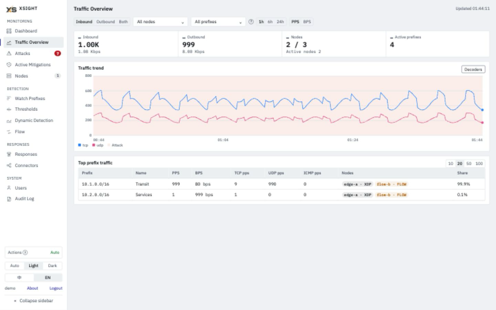
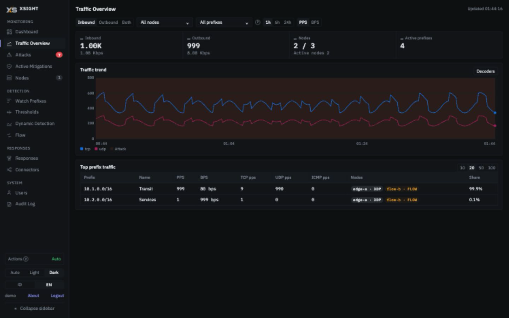

<div align="center">
  

  <h1>YemenAntiDDoS</h1>

  <p>Distributed DDoS detection and response platform built on XDP/eBPF — wire-speed traffic analysis with automated mitigation.</p>

  [](https://go.dev)
  [](https://vuejs.org)
  [](LICENSE)
  [](https://claude.com/product/claude-code)

  [Live demo (sample data)](https://d80y6.github.io/YemenAntiDDoS/)
</div>

---

## What is YemenAntiDDoS?

YemenAntiDDoS is a distributed DDoS detection and response platform that combines XDP/eBPF wire-speed packet counting with flow-based analysis (sFlow, NetFlow, IPFIX). It watches traffic on mirror/ERSPAN ports or ingests flow data from routers and switches, detects volumetric attacks using both hard thresholds and dynamic baselines, and triggers automated responses — from BPF-level firewall rules to BGP blackhole announcements.

The system has two components:

- **Node** — deployed at each observation point, captures traffic via XDP or receives flow data, counts per-IP/per-protocol statistics, and streams them to the controller over gRPC
- **Controller** — central management plane that runs the detection engine, stores time-series data in TimescaleDB, triggers response actions, and serves the Web UI

| Light | Dark |
|:---:|:---:|
|  |  |

```
┌──────────────────────────────────────────────────────────────────────────┐
│                          Controller (Detection Plane)                    │
│                                                                          │
│  ┌──────────┐  ┌──────────┐  ┌──────────┐  ┌──────────┐  ┌───────────┐ │
│  │  Web UI  │  │ HTTP API │  │Detection │  │ Response │  │TimescaleDB│ │
│  │ Vue 3 +  │  │  (Gin)   │  │ Engine   │  │ Actions  │  │    (PG)   │ │
│  │TypeScript│  │          │  │          │  │          │  │           │ │
│  └──────────┘  └──────────┘  └──────────┘  └──────────┘  └───────────┘ │
└────────────────────────────────┬─────────────────────────────────────────┘
                                 │  gRPC (stats streaming + config publish)
             ┌───────────────────┼───────────────────┐
             ▼                   ▼                   ▼
      ┌─────────────┐    ┌─────────────┐    ┌─────────────┐
      │  Node 1     │    │  Node 2     │    │  Node N     │
      │  (XDP mode) │    │ (Flow mode) │    │  (XDP mode) │
      │ ┌─────────┐ │    │ ┌─────────┐ │    │ ┌─────────┐ │
      │ │ BPF/XDP │ │    │ │  sFlow  │ │    │ │ BPF/XDP │ │
      │ │ counter │ │    │ │ NetFlow │ │    │ │ counter │ │
      │ └─────────┘ │    │ └─────────┘ │    │ └─────────┘ │
      └─────────────┘    └─────────────┘    └─────────────┘
       Mirror/ERSPAN      Router/Switch      Mirror/ERSPAN
```

---

## Key Features

### Dual Capture Mode

| Mode | How it works | Use case |
|------|-------------|----------|
| **XDP** | BPF program on mirror/ERSPAN port counts packets at wire speed | High-accuracy, per-packet visibility |
| **Flow** | sFlow, NetFlow v5/v9, IPFIX receiver with multi-source support | Router/switch integration, no kernel dependency |

### Detection Engine
- **Hard threshold detection** — per-decoder limits (PPS + BPS). Built-in decoders: TCP, TCP SYN, UDP, ICMP, fragment, TCP ACK/RST/FIN, GRE, ESP, IGMP, `ip_other`, `bad_fragment`, `invalid` — 14 total, expandable to 16
- **Dynamic baseline detection** — EWMA with 168-slot weekly profile (one slot per hour); alerts on percentage deviation from learned baseline
- **Bidirectional detection** — monitors both inbound and outbound traffic independently
- **Global carpet bomb detection** — 0.0.0.0/0 aggregate threshold catches distributed attacks spread across many IPs
- **Per-decoder granularity** — separate thresholds for each protocol decoder (dynamic baselines are per prefix, for all inbound traffic)

### Response System
| Action | Description |
|--------|-------------|
| **xDrop** | Create filter / rate-limit rules through the xDrop v3 controller API for wire-speed blocking |
| **BGP RTBH** | Announce the attacked prefix (a single /32 or /128, or a subnet) as a blackhole route via BGP for upstream null-routing |
| **Webhook** | HTTP callback to external systems (SIEM, Slack, PagerDuty, etc.) |
| **Shell** | Execute local scripts for custom automation |

- **Auto-paired actions** — creating an xDrop/BGP `on_detected` action auto-creates the matching `on_expired` cleanup (unblock / withdraw), kept in sync through the parent's lifecycle
- **Auto `tcp_flags` injection** — TCP-flag attacks automatically add `protocol=tcp` and the matching flag pattern to xDrop rules (SYN flood: `tcp_flags=SYN,!ACK`; ACK, RST and FIN floods likewise)
- **Rule narrowing and top-K rules** — port and source-IP fields narrow only when flow samples show a clear dominant value; otherwise a rule can expand into one rule per top port, or a `drop` rule falls back to a rate limit (see [Known Limitations](#known-limitations))
- **xDrop decoder compatibility gate** — dispatch follows the compatible decoder set; `ip` / `ip_other` aggregate attacks are not dispatched to xDrop (`decoder_not_xdrop_compatible`).
- **Shared BGP announcements (Wanguard-style)** — multiple attacks sharing a `(prefix, route_map)` ref a single FRR route. MAX delay across attached attacks, atomic attach/detach under `SELECT FOR UPDATE`.
- **Persisted delayed tasks** — `scheduled_actions` table survives controller restart; startup reconciliation re-arms pending timers, fires overdue tasks, retries in-flight crashed tasks.
- **FRR orphan detection** — startup scan surfaces FRR routes with no backing YemenAntiDDoS attack so operators can withdraw or dismiss them.
- **BGP Flowspec** — Multi-vendor BGP Flowspec rule generation and management (Cisco XR, Juniper, Arista, FRR) with console preview, inspection, and force-withdraw. See [docs/FLOWSPEC.md](docs/FLOWSPEC.md) (AR: [docs/FLOWSPEC.ar.md](docs/FLOWSPEC.ar.md)).
- **Layer 7 Inspection** — HTTP flood, Slowloris, and TLS ClientHello detection on the Node with in-memory aggregation and a dedicated L7 dashboard in the console. See [docs/L7.md](docs/L7.md).
- **mTLS Management** — Peer certificate tracking and posture indicators in the node management UI. Setup guide: [docs/MTLS.md](docs/MTLS.md) (AR: [docs/MTLS.ar.md](docs/MTLS.ar.md)).

### Active Mitigations & Per-Attack Drilldown
- Dedicated `Active Mitigations` page showing BGP Routing and XDrop Rules sections on one page, with a detail drawer per artifact (fields, Delivery for xDrop, Execution Timeline); Delivery queries current per-node xDrop state.
- The attack-detail page shows a `BGP Role` column (triggered / attached to a shared announcement) and a Force remove button; for BGP, it withdraws the entire shared route, removing protection for every attached attack.

### Observability
- Prometheus `/metrics` endpoint with YemenAntiDDoS-specific metrics (vtysh ops, action dispatches, skip reasons, scheduled-action recovery outcomes, state-table gauges, tracker counters) plus Go runtime / process metrics for free.
- Custom collectors read DB state at scrape time — always fresh, no staleness window, no background refresh goroutine.

### Traffic Analysis
- **Flow fingerprint** — 5-tuple sampling during attacks captures top talkers and protocol distribution
- **Sensor logs** — per-event structured logs with full decoder breakdown
- **Per-IP tracking** — real-time per-destination PPS/BPS with configurable aggregation windows

### Web UI
- **Appearance** — Auto / Light / Dark
- **Internationalization** — full English and Arabic (RTL) UI with an EN/AR toggle
- **Real-time dashboards** — traffic overview, per-IP drilldown, alert timeline, response history
- **Config management** — detection profiles, response actions, and node configuration from the browser

### Data Pipeline
- **TimescaleDB** — continuous aggregates for efficient time-range queries, automatic compression, and configurable retention policies
- **Config publish pipeline** — Controller pushes the watch configuration (watched prefixes, flow listeners and sources) to nodes via gRPC `ControlStream`, ensuring all nodes stay in sync without polling

---

## Repository Layout

```
yemenantiddos/
├── controller/          # Management plane (Go + Vue 3)
│   ├── internal/        # API, detection engine, tracker, actions, store
│   └── console/         # Vue 3 + TypeScript web console
├── node/                # Data plane (Go + BPF/XDP)
│   ├── internal/        # BPF loader, reporter, sampler, flow decoder
│   └── bpf/             # XDP kernel program (C)
├── shared/              # Shared decoder package
├── proto/               # gRPC service definition
├── scripts/             # Build & service management
├── deploy/              # systemd unit files + Docker files (deploy/docker/Dockerfile.node)
└── .github/assets/      # Logo, screenshots, sponsor
```

---

## Requirements

| Component | Requirements |
|-----------|-------------|
| Controller | Go 1.25+, Node.js 22.12+ to build (console tests need 22.22.2+ or 24.15+), PostgreSQL 15+ with TimescaleDB 2.x (required) |
| Node (XDP mode) | Linux 5.18+ (the XDP program uses `bpf_xdp_load_bytes`; verified on Debian 13 / kernel 6.12), x86_64 only, Go 1.24+, clang/llvm 11+, bpftool (generates `vmlinux.h`) and libbpf headers, root / CAP_NET_ADMIN + CAP_BPF |
| Node (Flow mode) | Linux x86_64, Go 1.24+; no XDP attach at runtime, but the build needs the same BPF toolchain as XDP mode |

**Hardware (Controller — includes PostgreSQL + TimescaleDB):**

| | CPU | RAM | Disk | Use Case |
|--|-----|-----|------|----------|
| **Minimum** | 4 cores | 8 GB | 40 GB SSD | Small networks, fewer prefixes |
| **Recommended** | 8 cores | 16 GB | 80 GB SSD | Production, high-traffic environments |

**Hardware (Node):**

| | CPU | RAM | Disk | Notes |
|--|-----|-----|------|-------|
| XDP mode | 2+ cores | 2 GB+ | 10 GB | Minimal — most work is in BPF kernel space |
| Flow mode | 2+ cores | 2 GB+ | 10 GB | Scales with number of flow exporters |

> **Both Node modes are built for Linux x86_64.** The Linux build always compiles the BPF objects (bpf2go `-target amd64`), so it needs `node/bpf/vmlinux.h` (generated with `bpftool btf dump file /sys/kernel/btf/vmlinux format c`) and libbpf headers even for flow mode. Only XDP mode attaches to the kernel's XDP hook. The **Controller** has no kernel requirement.

For a step-by-step environment setup guide, see **[Getting Started](GETTING_STARTED.md)**.

---

## Quick Start

### 1. Build

```bash
# Build controller (frontend + Go binary)
./scripts/build-controller.sh

# Build node (BPF program + Go binary) — run on a Linux host
./scripts/build-node.sh
```

### 2. Configure

```bash
# Controller
cp controller/config.example.yaml controller/config.yaml
# Edit: database.dsn, auth.api_key, auth.initial_admin_password,
#       action_engine.mode (observe = xDrop actions are only logged, auto = xDrop
#       rules are created; BGP / webhook / shell actions run in both modes)

# Node
cp node/config.example.yaml node/config.yaml
# Edit: node_id, capture mode (xdp/flow), interface, controller gRPC address,
#       auth.node_api_key
```

Before starting a Node, register it in the Web UI (**Nodes** page, or `POST /api/nodes`) with its `node_id` and an API key of your choice. Put that same key in the Node's `auth.node_api_key`; the Controller rejects handshakes from unregistered nodes or with a different key.

### 3. Start

```bash
# Controller (no root required)
./scripts/controller.sh start

# Node — the script requires root in both XDP and flow mode
sudo ./scripts/node.sh start

# Check status
./scripts/controller.sh status
./scripts/node.sh status
```

### 4. Or deploy with Docker

```bash
cp controller/config.example.yaml controller/config.yaml
# Edit: database.dsn -> postgres://xsight:<PASSWORD>@db:5432/xsight?sslmode=disable
#       auth.api_key / auth.initial_admin_password (placeholders are rejected)

export POSTGRES_PASSWORD=<the same password as in database.dsn>
docker compose up -d db controller
```

`docker-compose.yml` ships a TimescaleDB 16 service, the Controller image (Web UI `:8080`, node gRPC `:50051`), and an optional privileged Node image (`--profile node`, host networking for XDP/flow capture). For mTLS mount `./pki` and set `tls.enabled: true` on both sides — see [docs/MTLS.md](docs/MTLS.md).

The Controller image bundles `xsight-cert`, so the deployment CA and leaves can be generated without a Go toolchain on the host. `./pki` is mounted read-only into the running Controller; use a one-off container that mounts it read-write:

```bash
docker compose run --rm -v "$PWD/pki:/etc/xsight/pki" --entrypoint xsight-cert \
  controller init-ca --out /etc/xsight/pki --cn "xSight Deployment CA"
# then: issue --ca /etc/xsight/pki --cn controller ... and --node-id <id> ...
sudo chown -R 10001:10001 pki && chmod 700 pki && chmod 600 pki/*.key
```

Before first startup, set `auth.initial_admin_password` to a unique password of 8–72 bytes (not `admin`). The Web UI is available at `http://<controller-host>:8080`; sign in as `admin` with that configured password. The field can be removed after successful initialization.

When upgrading an existing database, set this field before restarting if any account with role `admin` still uses the legacy default password. Startup rotates those passwords, including renamed or disabled admins, without changing their names, roles, or enabled states. Without the setting, startup refuses to run while such an account exists. Already changed passwords are preserved. All users must sign in again after this upgrade.

Upgrading the v7 `ts_stats_5min` aggregate to v8 adds `avg_tcp_syn_bps` by rebuilding it: 5-minute aggregates older than 7 days are deleted, and startup synchronously backfills only the last 7 days from available raw data (a fixed window, independent of `ts_stats_days`). Shorter raw retention can leave less history to rebuild. Pre-upgrade raw rows have `tcp_syn_bps = 0`.

For upgrade notes and release changes, see [CHANGELOG](CHANGELOG.md).

The last enabled admin cannot be deleted, demoted or disabled; the API returns 409.

---

## Known Limitations

### The Controller–Node link is plaintext unless mTLS is enabled

gRPC between Node and Controller defaults to plaintext. When `tls.enabled` is set on both sides, the link uses TLS 1.3 mutual authentication and the Controller takes the node identity from the client certificate's URI SAN (`spiffe://xsight/node/<node_id>`) instead of the `node_id` field in each message. Without mTLS, after a node's first successful handshake the Controller still accepts statistics by the `node_id` written in each message, so deploy only on a trusted network or inside a VPN / encrypted tunnel and firewall the gRPC port (default 50051). Setup, rotation and revocation: [docs/MTLS.md](docs/MTLS.md) (AR: [docs/MTLS.ar.md](docs/MTLS.ar.md)).

### xDrop port fields depend on flow samples

Port and source-IP fields of an xDrop rule (`{dominant_dst_port}`, `{dominant_src_port}`, `{src_ip}`) are filled from the attack's sampled flows when the action runs. A field is kept only with at least `action_engine.xdrop_min_sample_packets` sampled packets (default 1000) and a dominant share of at least `xdrop_narrow_pct` (default 80%). Setting `action_engine.xdrop_adaptive_samples: true` lowers that floor to `base/10` when the dominant share is at least 90% (and `base/20` at 95%), which lets short hit-and-run floods narrow instead of falling back to a broad rule; `action_engine.fast_path_multiplier` (default 5.0) also confirms an attack on the first tick when the measured rate is that many times the threshold. Otherwise the field is dropped, or the top ports become several rules (up to `xdrop_topk_max`, default 8). A `drop` rule that ends up with no narrowing field becomes a `rate_limit` at the attack's pps threshold. Early in an attack the rule can therefore be broader than the template suggests. To wait for a clear dominant port, add a precondition such as:

```
dominant_dst_port_pct  gte  40
```

Execution logs record each decision as `shape: ...` notes; see the [Controller API reference](controller/API.md#createupdate-action).

### Other limitations

- Actions with **Execution = Manual** are never executed; there is no manual trigger yet.
- The `CriticalEventStream` RPC is reserved and not used; node-side hard thresholds are not enforced on the Node.
- Unknown or misspelled keys in `config.yaml` are silently ignored.
- Only PostgreSQL (with TimescaleDB) is supported; `database.driver: sqlite` exits at startup.
- `./scripts/controller.sh status` checks the API without credentials, so it always reports the API as "not responding"; use the Web UI or the log to confirm the Controller is serving.

---

## License

MIT — see [LICENSE](LICENSE).

BPF/C kernel programs (`node/bpf/`) are licensed under GPL-2.0 as required by the Linux kernel BPF subsystem.

