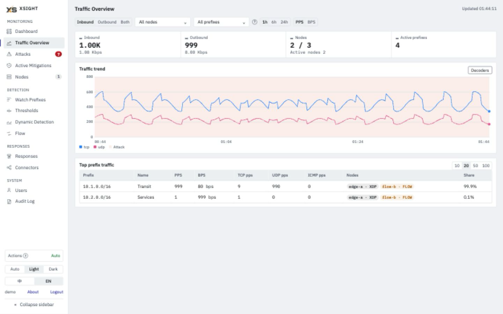
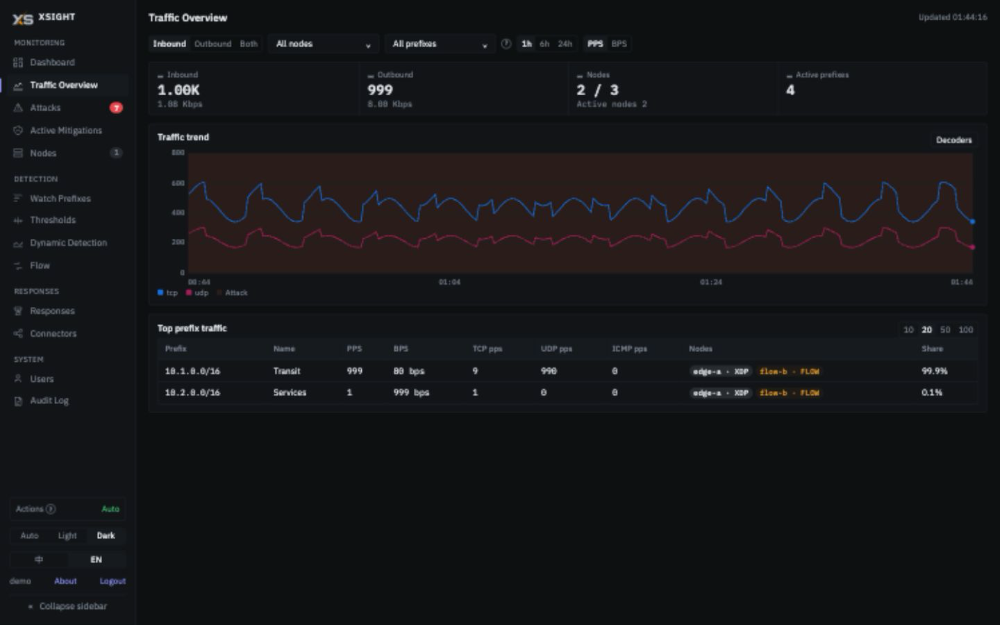

<div align="center">
  

  <h1>xSight</h1>

  <p>基于 XDP/eBPF 的分布式 DDoS 检测与响应平台 — 线速流量分析，自动化缓解。</p>

  [](https://go.dev)
  [](https://vuejs.org)
  [](LICENSE)
  [](https://claude.com/product/claude-code)

  [English](README.md) · [在线演示（示例数据）](https://littlewolf9527.github.io/xsight/)
</div>

---

## 项目简介

xSight 是一套分布式 DDoS 检测与响应平台，融合了 XDP/eBPF 线速抓包计数与 Flow 分析（sFlow、NetFlow、IPFIX）两种采集模式。它通过监控镜像/ERSPAN 端口的流量或接收路由器/交换机的 Flow 数据，利用硬阈值与动态基线双重检测机制识别容量型攻击，并触发自动响应 — 从 BPF 防火墙规则到 BGP 黑洞路由。

系统由两个组件构成：

- **Node（节点）** — 部署在每个观测点，通过 XDP 抓包或接收 Flow 数据，按 IP/协议维度统计流量，通过 gRPC 流式上报至 Controller
- **Controller（控制器）** — 集中管控平面，运行检测引擎，使用 TimescaleDB 存储时序数据，触发响应动作，并提供 Web UI

| 浅色 | 深色 |
|:---:|:---:|
|  |  |

```
┌──────────────────────────────────────────────────────────────────────────┐
│                        Controller（检测与管控平面）                        │
│                                                                          │
│  ┌──────────┐  ┌──────────┐  ┌──────────┐  ┌──────────┐  ┌───────────┐ │
│  │  Web UI  │  │ HTTP API │  │  检测    │  │  响应    │  │TimescaleDB│ │
│  │ Vue 3 +  │  │  (Gin)   │  │  引擎    │  │  动作    │  │    (PG)   │ │
│  │TypeScript│  │          │  │          │  │          │  │           │ │
│  └──────────┘  └──────────┘  └──────────┘  └──────────┘  └───────────┘ │
└────────────────────────────────┬─────────────────────────────────────────┘
                                 │  gRPC（统计上报 + 配置下发）
             ┌───────────────────┼───────────────────┐
             ▼                   ▼                   ▼
      ┌─────────────┐    ┌─────────────┐    ┌─────────────┐
      │  节点 1     │    │  节点 2     │    │  节点 N     │
      │ （XDP 模式）│    │（Flow 模式）│    │ （XDP 模式）│
      │ ┌─────────┐ │    │ ┌─────────┐ │    │ ┌─────────┐ │
      │ │ BPF/XDP │ │    │ │  sFlow  │ │    │ │ BPF/XDP │ │
      │ │  计数器  │ │    │ │ NetFlow │ │    │ │  计数器  │ │
      │ └─────────┘ │    │ └─────────┘ │    │ └─────────┘ │
      └─────────────┘    └─────────────┘    └─────────────┘
       镜像/ERSPAN        路由器/交换机       镜像/ERSPAN
```

---

## 核心特性

### 双模采集

| 模式 | 工作原理 | 适用场景 |
|------|---------|---------|
| **XDP** | BPF 程序挂载在镜像/ERSPAN 端口，线速逐包计数 | 高精度、逐包可见性 |
| **Flow** | sFlow、NetFlow v5/v9、IPFIX 接收器，支持多源 | 路由器/交换机集成，无内核依赖 |

### 检测引擎
- **硬阈值检测** — 按协议解码器独立设置 PPS 和 BPS 阈值。内置解码器：TCP、TCP SYN、UDP、ICMP、fragment、TCP ACK/RST/FIN、GRE、ESP、IGMP、`ip_other`、`bad_fragment`、`invalid`——共 14 个，可扩展到 16
- **动态基线检测** — EWMA 算法，168 槽位周循环画像（每小时一个槽位），基于学习到的基线百分比偏差告警
- **双向检测** — 独立监控入向和出向流量
- **全局地毯式轰炸检测** — 0.0.0.0/0 聚合阈值，捕获分散在大量 IP 上的分布式攻击
- **解码器级粒度** — 每种协议解码器可独立配置阈值（动态基线按前缀统计全部入向流量）

### 响应系统
| 动作 | 说明 |
|------|------|
| **xDrop** | 通过 xDrop v3 控制器 API 创建过滤 / 限速规则，实现线速封堵 |
| **BGP RTBH** | 通过 BGP 把被攻击的前缀（单个 /32、/128 或子网）宣告为黑洞路由，由上游进行 null-route |
| **Webhook** | HTTP 回调至外部系统（SIEM、Slack、PagerDuty 等） |
| **Shell** | 执行本地脚本，用于自定义自动化 |

- **自动配对动作** — 创建 xDrop/BGP `on_detected` 动作时自动创建对应的 `on_expired` 清理动作（unblock / withdraw），跟随父动作的生命周期同步
- **自动 `tcp_flags` 注入** — TCP 标志类攻击自动为 xDrop 规则添加 `protocol=tcp` 和对应的标志模式（SYN Flood：`tcp_flags=SYN,!ACK`；ACK、RST、FIN Flood 同理）
- **规则收窄与前 K 名多规则** — 端口与源 IP 字段只在 Flow 采样显示出明确的主导值时才收窄；否则一条规则可能按排名靠前的端口拆成多条，或 `drop` 规则退成限速（见[已知限制](#已知限制)）
- **xDrop decoder 兼容闸门** — 按兼容 decoder 范围派发；`ip` / `ip_other` 聚合攻击不派发到 xDrop（`decoder_not_xdrop_compatible`）。
- **共享 BGP 公告（Wanguard 风格）** — 多个攻击落到同一 `(prefix, route_map)` 时复用同一条 FRR 路由。所有 attach 攻击的 MAX 延迟、`SELECT FOR UPDATE` 下的原子 attach/detach
- **持久化延迟任务** — `scheduled_actions` 表跨 Controller 重启；启动时 re-arm pending timer、立即 fire 逾期任务、retry 执行中途崩溃的任务
- **FRR 孤儿检测** — 启动扫 FRR，发现没有对应攻击的残留路由并交给运维处理

### 活跃缓解与逐攻击下钻
- 「缓解」页在同一页展示「BGP 宣告」与「XDrop 规则」分区；详情抽屉包含字段、XDrop 的「下发」与「执行时间线」，下发状态按需查询各节点。
- 攻击详情页提供「BGP 角色」（触发 / 附加）和「强制移除」；对 BGP 执行该操作会撤回整条共用路由，所有挂载攻击都会失去该路由的保护。

### 可观测性
- Prometheus `/metrics` 端点，xSight 专用指标（vtysh 操作、动作分派、skip 原因、scheduled-action 恢复结果、状态表 gauge、攻击追踪计数器），还免费附带 Go runtime / process 指标。
- Custom collector 在 scrape 时直接读 DB——永远新鲜，无陈旧窗口，也无需后台刷新 goroutine。

### 流量分析
- **Flow 指纹** — 攻击期间进行五元组采样，捕获 Top Talker 和协议分布
- **传感器日志** — 每事件结构化日志，包含完整的解码器维度拆分
- **逐 IP 跟踪** — 实时按目的 IP 统计 PPS/BPS，可配置聚合窗口

### Web UI
- **外观** — 自动 / 浅 / 深
- **国际化** — 完整的中英文支持（ZH/EN 切换）
- **实时仪表盘** — 流量概览、逐 IP 下钻、告警时间线、响应历史
- **配置管理** — 在浏览器中管理检测配置、响应动作和节点配置

### 数据管线
- **TimescaleDB** — 连续聚合实现高效时间范围查询，自动压缩，可配置数据保留策略
- **配置下发管线** — Controller 通过 gRPC `ControlStream` 将监控配置（监控前缀、Flow 监听器与数据源）推送至节点，无需轮询即可保持所有节点同步

---

## 项目结构

```
xsight/
├── controller/          # 管控平面（Go + Vue 3）
│   ├── internal/        # API、检测引擎、跟踪器、响应动作、存储
│   └── console/         # Vue 3 + TypeScript 控制台
├── node/                # 数据平面（Go + BPF/XDP）
│   ├── internal/        # BPF 加载器、上报器、采样器、Flow 解码器
│   └── bpf/             # XDP 内核程序（C）
├── shared/              # 共享解码器包
├── proto/               # gRPC 服务定义
├── scripts/             # 编译与服务管理脚本
├── deploy/              # systemd 服务文件
└── .github/assets/      # Logo、截图、赞助商
```

---

## 环境要求

| 组件 | 要求 |
|------|------|
| Controller | Go 1.25+、Node.js 22.12+（构建；跑控制台测试需 22.22.2+ 或 24.15+）、PostgreSQL 15+，必须安装 TimescaleDB 2.x |
| Node（XDP 模式） | Linux 5.18+（XDP 程序使用 `bpf_xdp_load_bytes`；在 Debian 13 / kernel 6.12 上验证）、仅 x86_64、Go 1.24+、clang/llvm 11+、bpftool（生成 `vmlinux.h`）与 libbpf 头文件、root / CAP_NET_ADMIN + CAP_BPF |
| Node（Flow 模式） | Linux x86_64、Go 1.24+；运行时不挂 XDP，但编译需要与 XDP 模式相同的 BPF 工具链 |

**硬件配置（Controller — 包含 PostgreSQL + TimescaleDB）：**

| | CPU | 内存 | 磁盘 | 适用场景 |
|--|-----|------|------|----------|
| **最低配置** | 4 核 | 8 GB | 40 GB SSD | 小型网络，前缀数较少 |
| **推荐配置** | 8 核 | 16 GB | 80 GB SSD | 生产环境，大流量场景 |

**硬件配置（Node）：**

| | CPU | 内存 | 磁盘 | 备注 |
|--|-----|------|------|------|
| XDP 模式 | 2 核+ | 2 GB+ | 10 GB | 开销极低 — 大部分工作在 BPF 内核空间完成 |
| Flow 模式 | 2 核+ | 2 GB+ | 10 GB | 随 Flow exporter 数量线性增长 |

> **两种 Node 模式都按 Linux x86_64 编译。** Linux 构建总会编译 BPF 对象（bpf2go `-target amd64`），因此即使是 Flow 模式也需要 `node/bpf/vmlinux.h`（用 `bpftool btf dump file /sys/kernel/btf/vmlinux format c` 生成）和 libbpf 头文件。只有 XDP 模式会挂到内核的 XDP hook 上。**Controller** 没有内核要求。

详细的环境准备步骤请参见**[快速开始](GETTING_STARTED.zh.md)**。

---

## 快速开始

### 1. 编译

```bash
# 编译 controller（前端 + Go 二进制）
./scripts/build-controller.sh

# 编译 node（BPF 程序 + Go 二进制）——需在 Linux 主机上执行
./scripts/build-node.sh
```

### 2. 配置

```bash
# Controller
cp controller/config.example.yaml controller/config.yaml
# 编辑：database.dsn、auth.api_key、auth.initial_admin_password、
#       action_engine.mode（observe = xDrop 动作只记录不下发，auto = 真正创建
#       xDrop 规则；BGP / Webhook / Shell 动作在两种模式下都会执行）

# Node
cp node/config.example.yaml node/config.yaml
# 编辑：node_id、采集模式（xdp/flow）、网卡、Controller gRPC 地址、
#       auth.node_api_key
```

启动 Node 之前，先在 Web UI（**节点**页，或 `POST /api/nodes`）用该节点的 `node_id` 和自定的 API 密钥注册它，再把同一个密钥填进该 Node 的 `auth.node_api_key`；未注册的节点或密钥不一致时，Controller 拒绝握手。

### 3. 启动

```bash
# 启动 controller（无需 root）
./scripts/controller.sh start

# 启动 node — XDP 与 Flow 模式下脚本都要求 root
sudo ./scripts/node.sh start

# 查看状态
./scripts/controller.sh status
./scripts/node.sh status
```

首次启动前，将 `auth.initial_admin_password` 设为 8–72 字节的独立密码（不能为 `admin`）。Web UI 地址为 `http://<controller-host>:8080`，使用用户名 `admin` 和该配置密码登录。初始化成功后可删除此字段。

升级已有数据库时，如果任何 `admin` 角色账号仍使用旧默认密码，重启前需设置此字段。启动时会轮换这些账号的密码（包括改名或已停用的管理员），保留用户名、角色和启停状态；未配置时拒绝启动。已经改过的密码不会被覆盖。本次升级后所有用户需重新登录。

从 v7 升级时会重建 `ts_stats_5min`（v8，新增 `avg_tcp_syn_bps`）：7 天以前的 5 分钟聚合被删除，启动时同步从现存原始数据回填最近 7 天（固定 7 天，与 `ts_stats_days` 无关）；原始数据保留期更短时，可恢复的历史也更少。旧原始行的 `tcp_syn_bps` 为 0。

升级注意和版本变化见 [CHANGELOG](CHANGELOG.zh.md)。

最后一个启用的 admin 不能被删除、降级或停用；API 返回 409。

---

## 已知限制

### Controller 与 Node 之间的链路不加密

Node 与 Controller 之间的 gRPC 是明文；某节点首次握手成功后，Controller 按每条消息里自报的 `node_id` 接收统计。Controller 与 Node 只应部署在可信网络内，或放进 VPN / 加密隧道，并用防火墙限制 gRPC 端口（缺省 50051）。详见 [Node gRPC 接口 — 安全说明](node/API.zh.md#安全说明)。

### xDrop 端口字段依赖 Flow 采样

xDrop 规则的端口和源 IP 字段（`{dominant_dst_port}`、`{dominant_src_port}`、`{src_ip}`）在动作执行时按攻击的 Flow 采样填写。只有采样包数不少于 `action_engine.xdrop_min_sample_packets`（缺省 1000）、且主导值占比不低于 `xdrop_narrow_pct`（缺省 80%）时，该字段才保留。否则字段被丢弃，或把排名靠前的端口拆成多条规则（最多 `xdrop_topk_max` 条，缺省 8）。`drop` 规则若最终没有任何收窄字段，会退成按攻击 pps 阈值的 `rate_limit`。因此攻击刚开始时，规则可能比模板看上去的更宽。若要等出现明确的主导端口再动作，可加前置条件，例如：

```
dominant_dst_port_pct  gte  40
```

执行日志会以 `shape: ...` 提示记录每个决定；见 [Controller API 参考](controller/API.zh.md#创建更新动作)。

### 其他限制

- **执行方式 = 手动（Manual）** 的动作永远不会执行；目前没有手动触发入口。
- `CriticalEventStream` RPC 为保留通道、未使用；节点侧硬阈值不在 Node 上生效。
- `config.yaml` 中未知或拼错的键会被静默忽略。
- 只支持 PostgreSQL（配 TimescaleDB）；`database.driver: sqlite` 启动即退出。
- `./scripts/controller.sh status` 不带凭证检查 API，因此总是显示 API「not responding」；请用 Web UI 或日志确认 Controller 正在服务。

---

## 许可证

MIT — 详见 [LICENSE](LICENSE)。

BPF/C 内核程序（`node/bpf/`）遵循 GPL-2.0 协议，这是 Linux 内核 BPF 子系统的要求。

---

## 赞助商

<a href="https://www.hytron.io/">
<picture>
  <source media="(prefers-color-scheme: dark)" srcset=".github/assets/sponsor-hytron-dark.png">
  
</picture>
</a>
&nbsp;&nbsp;&nbsp;&nbsp;
<a href="https://www.yecaoyun.com/">
<picture>
  <source media="(prefers-color-scheme: dark)" srcset=".github/assets/sponsor-yecaoyun-dark.png">
  
</picture>
</a>

---

<sub>本项目完全通过 <a href="https://claude.com/product/claude-code">Claude Code</a> vibe coding 构建 — 包括 XDP/BPF 内核程序、gRPC 流式通信、检测引擎和 Vue 前端。</sub>
